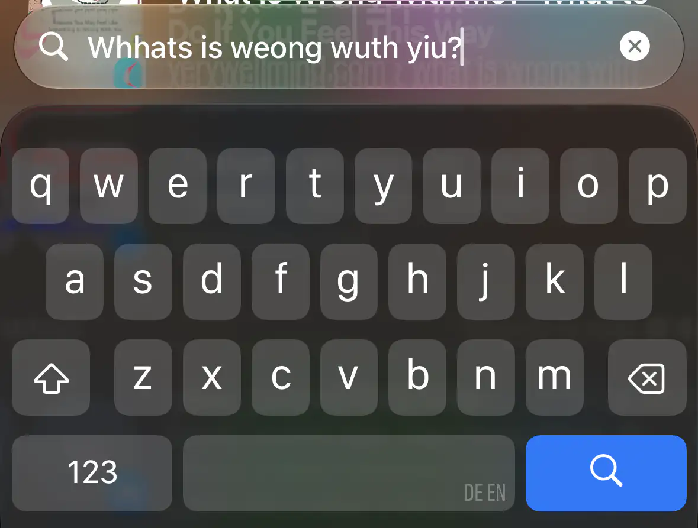

Having used Android for around 10 years, I was used to the convenience, the accuracy and the predictive correctness of Gboard, the official Google keyboard. Before Gboard, I was a happy user of SwiftKey and before that the Swype keyboard. After a while Google managed to include most if not all (I don't really recall) of the features I found useful in Swift and Swype into Gboard and I was a very happy Gboard user. Until I switched to an iPhone a couple of years ago due to being in the Apple ecosystem with the rest of my devices and the convenience of staying in the Apple ecosystem. 

Holy cow, what is wrong with the iOS keyboard? Okay to be honest, the answer to this particular question seems to be multi-faceted, querying Google with _iOS keyboard issues_ gives me a stunning 84.4 million results -- at least I'm not the only one. But my biggest gripe is simply with how bad autocorrect is. I haven't tried it so far but I think if I disable autocorrect, I will probably type faster than with autocorrect enabled. It regularly happens, that correctly spelled words and words that make *sense* in the sentence context get replaced by something utterly stupid. Or that I mistype a word and the edit-distance (e.g. Levenshtein) to the word I meant would be minimal but the iOS keyboard thinks that instead of changing a single character to correct it to the (to me) most likely word it would be better to change a total of 3-5 characters such that the final word is in no way associated with what I intended to type? What is wrong with you? Then there are cases where you correctly pressed a character and you actually saw the character pop-up of the keyboard but the keyboard decided to nevertheless insert a *different* character that what you typed correctly, see also [It's Not Just You - The iOS Keyboard is Broken](https://www.youtube.com/watch?v=hksVvXONrIo). Now since a couple of weeks (maybe it even aligns with my update to iOS 27) there is another bug: I open a chat, the keyboard pops up, I start typing "What" and the input field only contains "hat" -- it is repeatedly missing my first keypress.

Below I'll start a best of list of auto-corrected words which I will occasionally update.

| written                     | auto-corrected                  | note                                                 |
|-----------------------------|---------------------------------|------------------------------------------------------|
| Who is ...                  | **WHO** is ...                  | happens sometimes; come on, which word is more likely? I'm not sure if I ever wrote WHO on my iOS keyboard (meaning the world health organizaion)                          |
| ... something got stuck on ... | ... something got **S**tick on ... | that doesn't even make sense; also, why capitalize it? |

Then there is the option to install a third party keyboard in iOS which to be honest is not an actual valid option. Third party keyboards in iOS do not have the same permissions/access to the system as the iOS keyboard has and as such, they often behave weird and are spontaneously replaced with the iOS keyboard again and are in some situations not even available at all (e.g. on the lockscreen, entering passwords or device passcodes).

This is just a rant, as I just can't understand how Apple is able to produce such a terrible keyboard after 20 major iOS releases.

